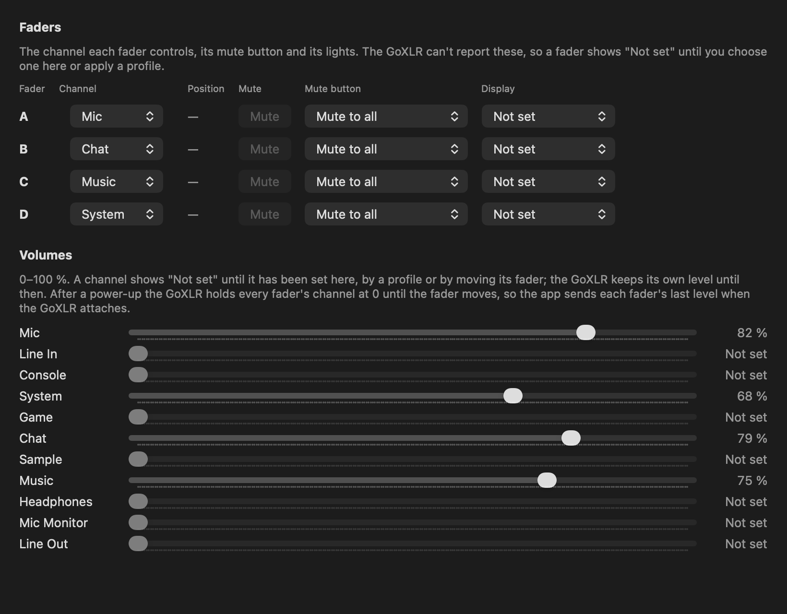

# GoXLR Mini Mac

Control a TC-Helicon **GoXLR Mini** from a Mac. TC-Helicon's GoXLR app runs only
on Windows. On a Mac the Mini plays audio as a standard USB interface, and
[goxlr-utility](https://github.com/GoXLR-on-Linux/goxlr-utility) can already
control it from user space (its macOS support is marked experimental). This
project takes another route: a macOS driver (DriverKit) that talks to the
Mini's controls, and a native menu bar app that uses it. Apple's own USB audio
driver keeps handling the sound.

Not affiliated with or endorsed by TC-Helicon or Music Tribe. GoXLR is their
trademark.

## Compared with goxlr-utility

goxlr-utility is the mature option. It supports the full-size GoXLR as well as
the Mini, including effects, the sampler and EQ, and it has a macOS installer.
Use it if you want something to install today. This project:

- supports only the Mini, and only what's listed below;
- has no download yet: you build it yourself;
- is a DriverKit driver and a SwiftUI menu bar app;
- keeps its safety rules in the driver: it refuses firmware updates and any
  command not on its list, and takes phantom power commands only from apps
  signed by the developer's team;
- was checked command by command on a Mini, with the evidence in
  [the ledger](docs/protocol/LEDGER.md).

Running both at once hasn't been tried; use one or the other.

## What works



Tested on one GoXLR Mini (firmware 1.1.8.43), macOS 27, Apple silicon:

- **Mixer:** channel volumes, which channel each fader controls, fader display
  modes, routing of each input to the Stream Mix, Chat Mic, headphones, sampler
  and line out.
- **Buttons:** fader mutes (to everything or to one output, hold to mute all),
  cough (hold or toggle), bleep light, inactive-button style.
- **Mic:** dynamic, condenser (48 V phantom power, only after you confirm) or
  TRS jack; gain up to 72 dB; noise gate; compressor; bleep volume; a live level
  meter. Every one of these was measured on the device.
- **Lights:** the colour of every light, and the animations.
- **Profiles:** save and apply any mix of mixer, mic and colours; five starting
  profiles; export and import as files; import official `.goxlr` profiles (no
  effects, sampler or scribbles); switch from the menu bar.

Not done: the Mini's EQ, the full-size GoXLR (its effects and sampler), Stream
Mix 2 and submixes (newer firmware), and audio through this driver. See
[docs/FEATURES.md](docs/FEATURES.md) and [docs/STATUS.md](docs/STATUS.md).

Safety: the driver checks every command against a fixed list and refuses
firmware updates and anything not on it. Phantom power goes on only from the
app, after you confirm a condenser mic. The Mini turns 48 V on at every
power-up, so for other mics the app turns it off again when the Mini attaches.

## Build it yourself

There's no signed download yet: distributing the driver needs Apple's approval
([ADR 0005](docs/decisions/0005-packaging.md)). You can build and run it on
your own Mac.

You need:

- a Mac with Apple silicon (Intel builds compile, but haven't been tried) and
  macOS 14 or later;
- Xcode;
- a paid Apple Developer Program membership. The driver needs DriverKit
  capabilities, which Apple gives development teams without a request, but a
  free account isn't a reliable way to get them.

Steps:

1. Copy `Config/Local.xcconfig.example` to `Config/Local.xcconfig` and set:
   - `DEVELOPMENT_TEAM` to your Team ID;
   - `XLR_BUNDLE_PREFIX` to your own reverse-DNS prefix, such as
     `com.yourname.xlr`. Bundle IDs are unique across all developer accounts,
     so the project's own prefix won't work for you.
2. In Xcode, sign in with your developer account (Settings → Accounts).
3. Build the `XLRHelper` scheme, in Xcode or with:
   ```bash
   xcodebuild -project XLR.xcodeproj -scheme XLRHelper -configuration Debug -allowProvisioningUpdates build
   ```
   Xcode creates the app IDs and development profiles. If it says your team
   has no devices, register this Mac in the developer portal (Certificates,
   Identifiers & Profiles → Devices) with the Provisioning UDID from
   `system_profiler SPHardwareDataType`, and build again.
4. Copy the built `GoXLR Mini Mac.app` to `/Applications`. macOS only activates
   drivers from apps there.
5. Open it, go to the **Device** page and click **Activate Driver**. Approve it
   in System Settings → General → Login Items & Extensions → Driver
   Extensions. If the app doesn't show the GoXLR as connected, unplug and
   replug it.
6. On the **Mic** page, choose your mic type. On the **Profiles** page, apply
   **Default Layout** for the usual fader channels, routing (the computer's
   channels to the headphones) and colours. macOS plays into the System
   channel, on fader D in Default Layout. The faders set the volumes, so a
   fader at the bottom is silent. The Mini forgets its mixer at every
   power-up; the app sends it again each time the Mini attaches ("Restore the
   mixer" on the Profiles page, on unless you turn it off), and the Mac is
   heard about 5 s after.

If the driver shows as activated but nothing connects, the development profile
built into the driver may not include this Mac (it was created before the Mac
was registered). Delete the driver's cached profile from
`~/Library/Developer/Xcode/UserData/Provisioning Profiles` and build again. The
details are in [ADR 0002](docs/decisions/0002-signing.md).

Development profiles expire after a year; rebuild then.

### Command line

`goxlrctl` reads the device and the driver's state, for debugging:

```bash
swift build -c release --package-path Tools/goxlrctl
```

It finds the driver through the installed app; set `XLR_DRIVER_BUNDLE_ID` if
yours is elsewhere. It isn't signed by your team, so the driver refuses its
riskier commands (phantom power).

### Tests

```bash
swift test --package-path Packages/GoXLRKit
```

## Uninstall

On the Device page, turn off **Open at Login** and click **Deactivate Driver**
(macOS asks for an administrator password). Then quit the app from the menu bar
and delete it from Applications. Settings live in `~/Library/Preferences/<prefix>.helper.plist`,
profiles in `~/Library/Application Support/XLR`.

## How it was made

The protocol was worked out from the vendor's Windows software (static
analysis only) and from [goxlr-utility](https://github.com/GoXLR-on-Linux/goxlr-utility)
(MIT), read for behaviour. Then every command the app sends was checked on a
Mini. The evidence is in [docs/protocol/LEDGER.md](docs/protocol/LEDGER.md)
and [docs/hardware](docs/hardware). No vendor code, binaries or firmware are in
this repository.

Comments and docs mention `PROMPT.md` and `PLAN.md`: the planning notes the
work followed (its phases and decisions D1–D8). They aren't published; the
decisions that matter are in [docs/decisions](docs/decisions).

## Layout

| Path | What |
|---|---|
| `Driver/` | The DriverKit driver: device matching, the command policy, the user client |
| `Helper/` | The menu bar app |
| `Packages/GoXLRKit/` | Shared Swift code: commands, mixer and button logic, profiles, the driver connection |
| `Tools/goxlrctl/` | Command-line tool |
| `Tests/Vectors/` | Protocol test vectors and an independent checker |
| `docs/` | Protocol notes, the evidence ledger, decisions, hardware sessions |

## License

[MIT](LICENSE).
